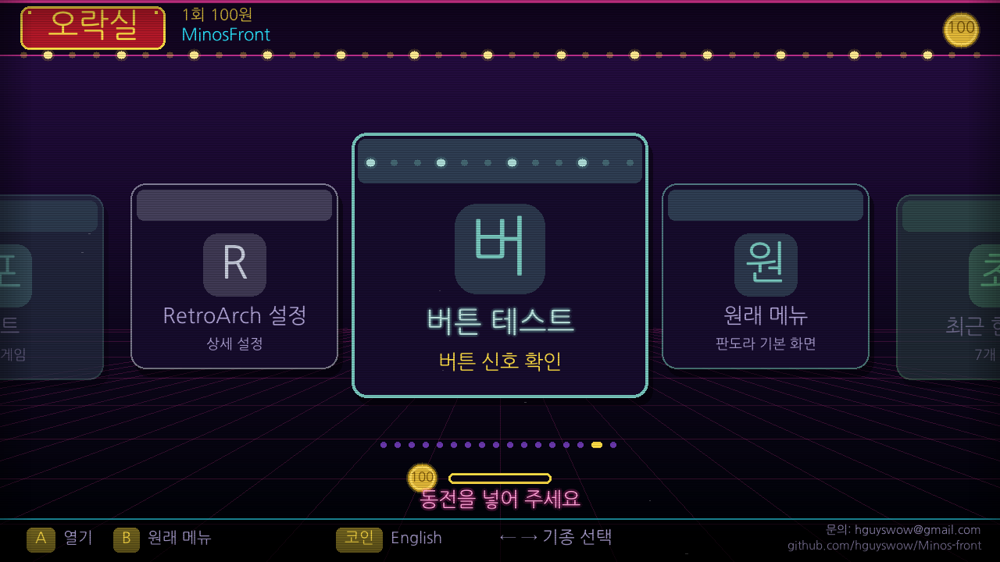
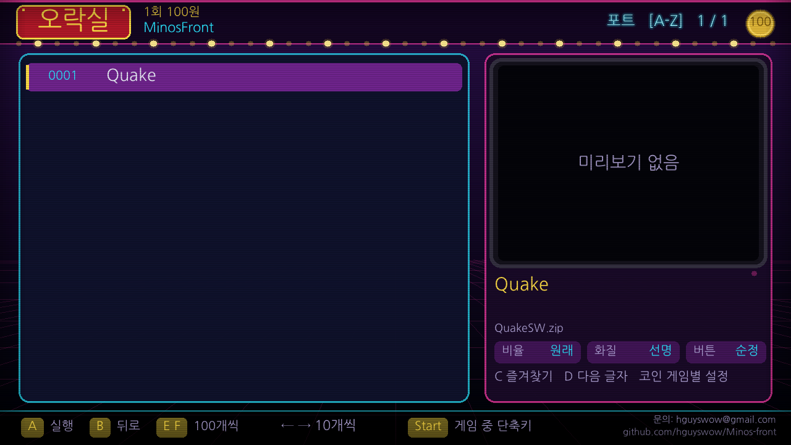
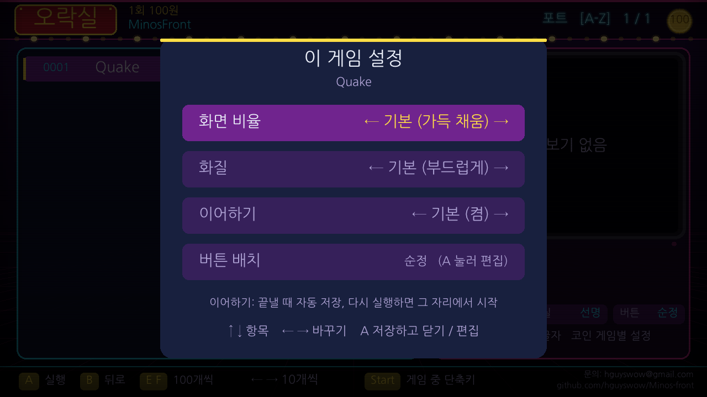
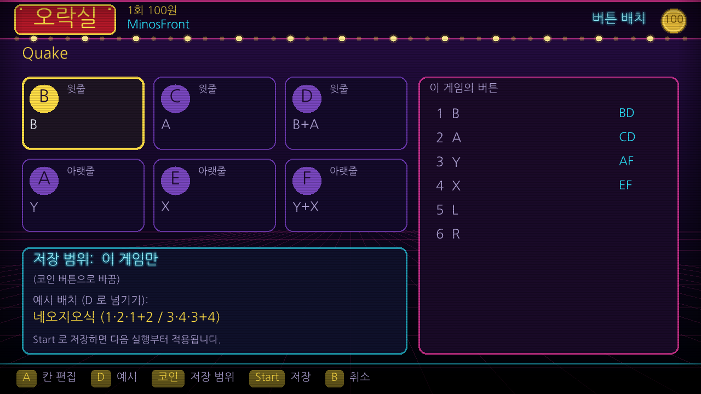
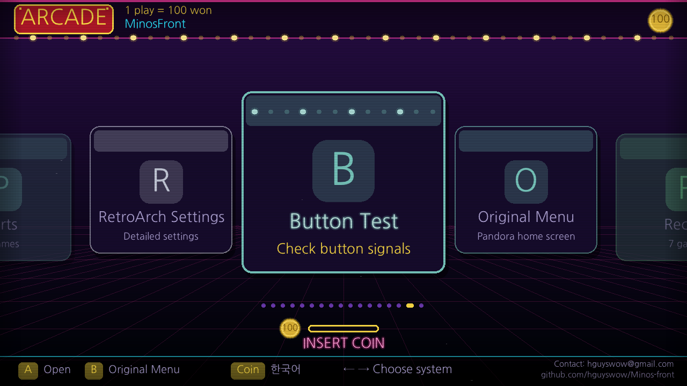
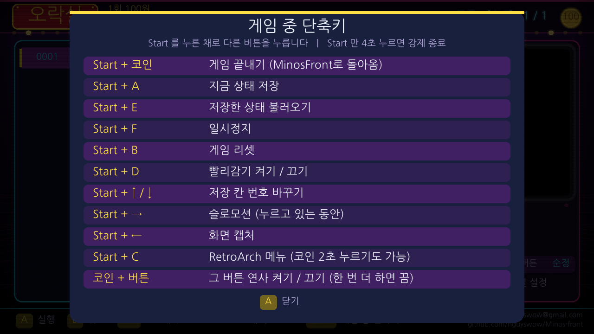
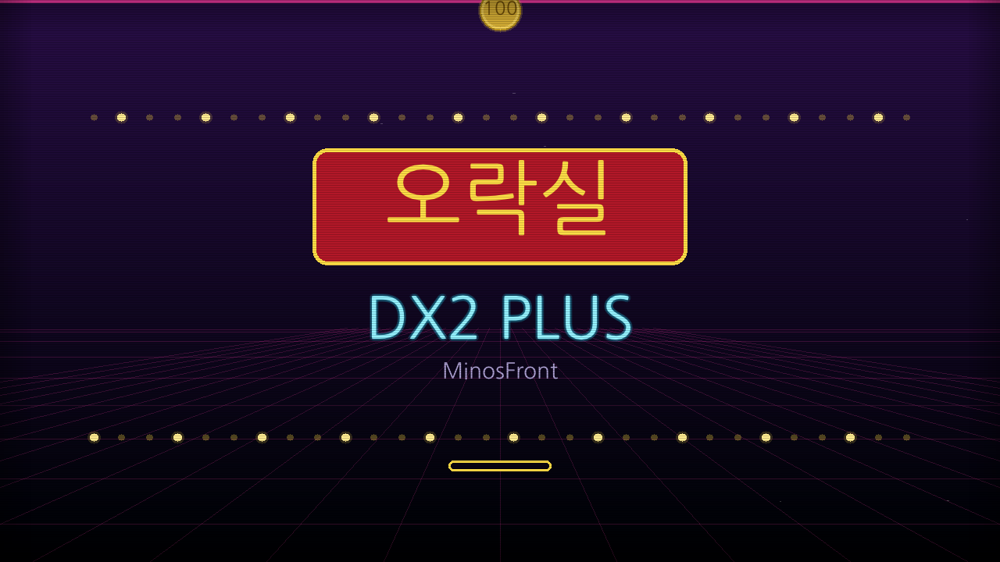
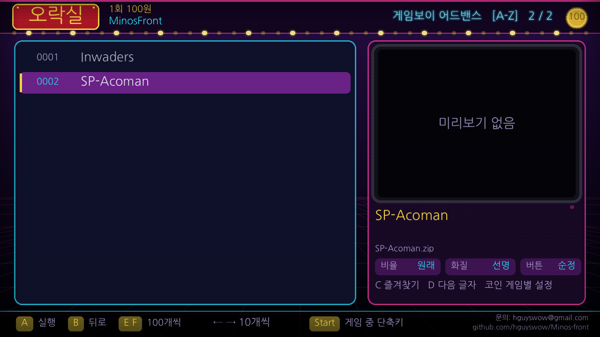

# Minos 오락실 — MinosFront for Pandora Saga DX2 Plus

An arcade-style game launcher, a custom RetroArch setup and a PC editor for the **Pandora Saga DX2 Plus** (Rockchip RK3128) — everything lives on the **SD card**, nothing is written to the internal flash.

판도라 사가 **DX2 Plus** 용 오락실 느낌의 게임 런처(MinosFront), 직접 빌드한 RetroArch 설정, PC 에디터 모음입니다. 전부 **SD 카드 안에서만** 동작하고 기기 내부 플래시는 건드리지 않습니다.

## What is inside / 구성

| Part | What it does |
|---|---|
| **MinosFront** (`tools/front/`) | SDL2 launcher: system carousel, game list with preview pictures, favorites, recent games, quick letter jump, per-game screen settings, **per-game button layouts (incl. "one key = two buttons")**, resume, English/Korean UI, button test, arcade theme with start-up splash. |
| **RetroArch setup** (`card/pandory/ra/`) | `ra.cfg`, per-system button layouts, 16-bit ALSA fix, hotkeys on **Start**, **Coin = turbo toggle**. Build script for RetroArch 1.22.2 in `tools/build_retroarch.sh`. |
| **Library data** (`card/pandory/library.tsv`, `buttons.tsv`) | The device's original 4,500+ game list with Korean names, the core that loads each game, and each game's button names. Tools to rebuild them in `tools/`. |
| **Card scripts** (`card/roms_pandory/scripts/`) | Menu scripts (run from the stock menu): start MinosFront, RetroArch menu, tests, "MinosFront at start-up" switch. |
| **PC editor** (`editor/`, `run_editor.py`) | Python/Tkinter editor for names, per-game settings, backups. |
| **Test tools** | Headless MinosFront tests under QEMU (`tools/front_test.sh`), key-layout test (`tools/test_keys.sh`), mock-Pandory test for the start-up hook (`tools/test_autostart.sh`). |

**Not included / 포함하지 않음:** ROMs, BIOS files, the device firmware, the stock libretro cores, preview videos, the Pandory executable. Bring your own legally obtained files. The RetroArch binary is not shipped either (GPLv3) — build it with `tools/build_retroarch.sh`.

## Quick start / 빠른 시작

1. Copy the contents of `card/` to the root of the SD card (keep your own `roms/`, `movies/`).
2. Put a RetroArch 1.22.2 ARM build at `pandory/ra/retroarch` (see `tools/build_retroarch.sh`).
3. On the device open the stock menu → scripts → **MinosFront** (`06_MinosFront`).
4. Optional: `python tools/build_previews.py F:` makes preview pictures from your preview videos.

Full guides: [docs/GUIDE_en.md](docs/GUIDE_en.md) · [docs/GUIDE_ko.md](docs/GUIDE_ko.md) · [docs/BUTTON_COMBOS.md](docs/BUTTON_COMBOS.md)

## Hotkeys in game / 게임 중 단축키

Hold **Start**, then press: **Coin** quit · **A** save state · **E** load state · **F** pause · **B** reset · **D** fast-forward · **↑/↓** state slot · **→** slow motion · **←** screenshot. Hold **Coin + any button** to toggle turbo fire on that button. Hold **Start alone 4 s** to force-quit.

## Screenshots

| | |
|---|---|
|  |  |
|  |  |
|  |  |

## Safety / 주의

Everything here is experimental and made for one specific device. It only touches files on the SD card, but use it at your own risk and keep a backup of your card. The optional "MinosFront at start-up" hook stops and restarts the stock menu; it switches itself off after two quick failures, and can be removed by deleting `pandory/front/autostart`.

## License

Source code: MIT (see `LICENSE`). Third-party parts keep their own licenses, see `NOTICE.md`.

Contact: hguyswow@gmail.com · https://github.com/hguyswow/Minos-front
